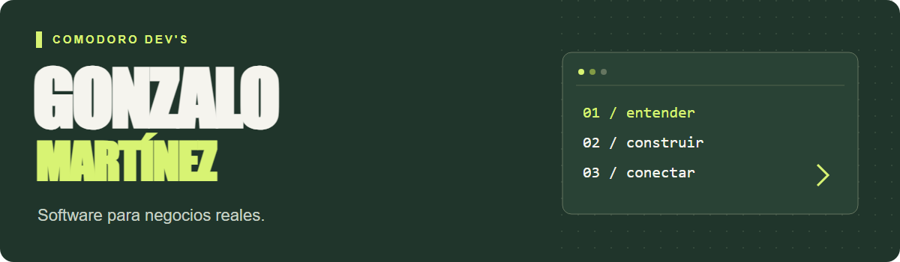

  

# Hola, soy Gonzalo 👋

Soy **Victor Gonzalo Martinez**, desarrollador de software. Estoy construyendo **Comodoro Dev's**, una iniciativa de desarrollo para pequeños y medianos negocios.

Me interesa convertir problemas cotidianos en herramientas simples: ordenar pedidos y stock, facilitar turnos y conectar procesos.

### Qué estoy construyendo

- **Software a medida** para acompañar la forma de trabajar de cada negocio.
- **Webs y herramientas digitales** para acercar negocios y clientes.
- **Automatizaciones e integraciones** para reducir tareas repetitivas.

### Tecnologías y herramientas

### Cómo encaro un proyecto

  

### Hablemos

¿Tenés una idea o un proceso que querés mejorar?

Podés [abrir un issue](https://github.com/GonzaMartinezDev/GonzaMartinezDev/issues/new) para conversar sobre una idea o propuesta.

---

*Tecnología cercana. Soluciones con sentido.*
